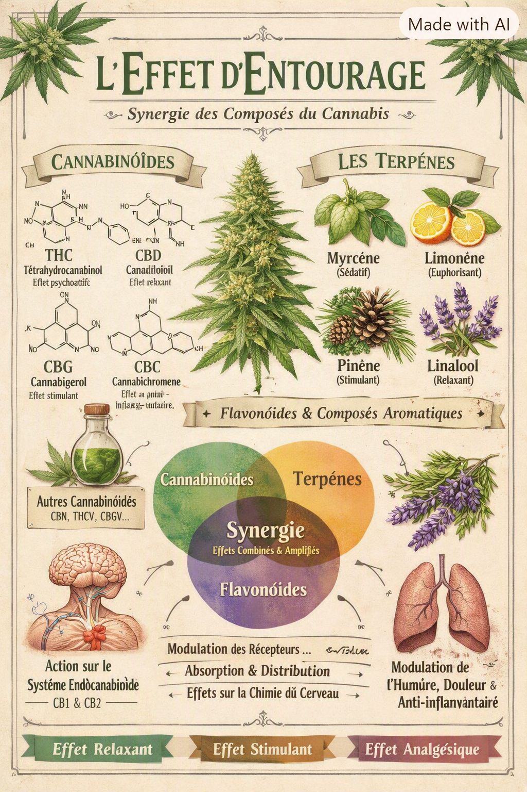

# L’effet d’entourage

#### 🌿 **1. Définition exacte : qu’est‑ce que l’effet d’entourage ?**

L’**effet d’entourage** désigne l’idée que les **molécules du cannabis n’agissent pas isolément**, mais **synergisent** entre elles pour produire un effet global **plus riche, plus complexe, et parfois plus puissant** que la somme de leurs effets individuels.

Il s’agit d’une **interaction biochimique** entre :

* **Cannabinoïdes** (THC, CBD, CBG, CBC, THCV, etc.)
* **Terpènes** (myrcène, limonène, pinène, linalool, caryophyllène, terpinolène…)
* **Flavonoïdes** (cannaflavines A, B, C)
* **Composés mineurs** (acides, esters, alcools aromatiques)

👉 L’effet final ressenti par l’humain dépend **du profil complet**, pas d’un seul composé.

<figure><figcaption></figcaption></figure>

#### 🧬 **2. Origine scientifique du concept**

Le terme “entourage effect” a été introduit en **1998** par les chercheurs **Ben-Shabat & Mechoulam**, qui ont observé que certains composés “inactifs” du cannabis **modifient** l’action des cannabinoïdes principaux.

Depuis, plusieurs études ont montré que :

* les terpènes **modulent** l’activité des récepteurs CB1/CB2,
* certains flavonoïdes **amplifient** les effets anti‑inflammatoires,
* les cannabinoïdes mineurs **changent la dynamique** du THC et du CBD.

Ce n’est pas un mythe : c’est un phénomène **biochimique réel**, même si encore en cours d’étude.

#### 🔥 **3. Comment l’effet d’entourage fonctionne réellement (mécanismes biologiques)**

**A. Récepteurs cannabinoïdes**

Certains terpènes peuvent :

* **augmenter** l’affinité du THC pour CB1,
* **réduire** l’anxiété induite par le THC,
* **modifier** la vitesse d’absorption.

Exemples :

* **Myrcène** → facilite la pénétration des molécules à travers la barrière hémato‑encéphalique.
* **Caryophyllène** → agoniste direct du récepteur **CB2** (anti‑inflammatoire).
* **Limonène** → influence la sérotonine et la dopamine (effet “uplifting”).

**B. Synergie cannabinoïdes ↔ terpènes**

Les terpènes ne sont pas seulement des “odeurs”. Ils **interagissent** avec les voies :

* GABA
* sérotonine
* dopamine
* noradrénaline
* adénosine
* TRPV1 (récepteur de la douleur)

👉 Ce mélange crée un **profil psychoactif unique** pour chaque cultivar.

<figure><figcaption></figcaption></figure>

**C. Modulation de l’inflammation**

Les flavonoïdes (cannaflavines A/B) ont des effets anti‑inflammatoires **30× plus puissants que l’aspirine**. Ils amplifient les effets du CBD et du CBC.

**D. Influence sur la pharmacocinétique**

Le mélange de terpènes + cannabinoïdes modifie :

* la vitesse d’absorption,
* la durée des effets,
* la distribution dans les tissus,
* la dégradation enzymatique.

#### 🌸 **4. L’effet d’entourage chez le cannabis : ce que ça change réellement**

**A. Le “type d’effet” dépend du profil terpénique**

Deux plantes avec le même taux de THC peuvent produire des effets **totalement différents** :

* **THC + myrcène** → effet lourd, relaxant, sédatif.
* **THC + limonène** → effet clair, énergisant, euphorique.
* **THC + pinène** → effet plus lucide, moins de perte de mémoire.
* **THC + linalool** → effet anxiolytique, calmant.

👉 Ce n’est pas le THC qui détermine l’effet, mais **le cocktail complet**.

**B. Le CBD modifie l’effet du THC**

* réduit l’anxiété,
* réduit la tachycardie,
* réduit les effets psychotomimétiques,
* augmente la clarté mentale.

**C. Les cannabinoïdes mineurs jouent un rôle clé**

* **CBG** → augmente la clarté mentale, effet “focus”.
* **CBC** → amplifie les effets du THC sur l’humeur.
* **THCV** → réduit l’appétit, effet plus “sharp”.

**D. Les flavonoïdes complètent l’ensemble**

Ils influencent :

* l’inflammation,
* la douleur,
* la neuroprotection,
* la stabilité aromatique.

#### 🌱 **5. Pourquoi l’effet d’entourage est important pour le cultivateur**

Parce que **tout ce que tu fais en culture influence le profil terpénique**, donc **l’effet final**.

#### Les facteurs qui modifient l’effet d’entourage :

* génétique (dominant)
* lumière (spectre, UV)
* stress contrôlé
* nutrition
* température
* séchage
* curing

👉 En optimisant ces facteurs, tu optimises **l’effet final**, pas seulement les terpènes.

#### 🧪 **6. Ce que l’effet d’entourage n’est PAS**

* Ce n’est pas une “magie” ou une croyance.
* Ce n’est pas une excuse pour dire “indica = relax, sativa = énergisant”.
* Ce n’est pas un concept marketing (même si certains l’utilisent comme tel).
* Ce n’est pas un effet mesurable par le taux de THC seul.

👉 C’est un phénomène **biochimique**, mesurable, reproductible, et démontré.

#### 🧬 **7. Synthèse claire**

| Composant                 | Rôle dans l’effet d’entourage                            |
| ------------------------- | -------------------------------------------------------- |
| **THC**                   | psychoactivité principale                                |
| **CBD**                   | modulateur du THC, anxiolytique                          |
| **Terpènes**              | direction de l’effet (uplifting, relaxant, clair, lourd) |
| **Cannabinoïdes mineurs** | nuances (focus, énergie, relaxation profonde)            |
| **Flavonoïdes**           | anti‑inflammatoires, stabilisation aromatique            |

👉 L’effet final = **interaction de tous ces éléments**.

#### 🔥 Conclusion

L’effet d’entourage est **le cœur de la complexité du cannabis**. Ce n’est pas le THC, ni les terpènes, ni le CBD qui déterminent l’effet : c’est **leur interaction synergique**, influencée par la génétique, la culture, et la post‑récolte.

