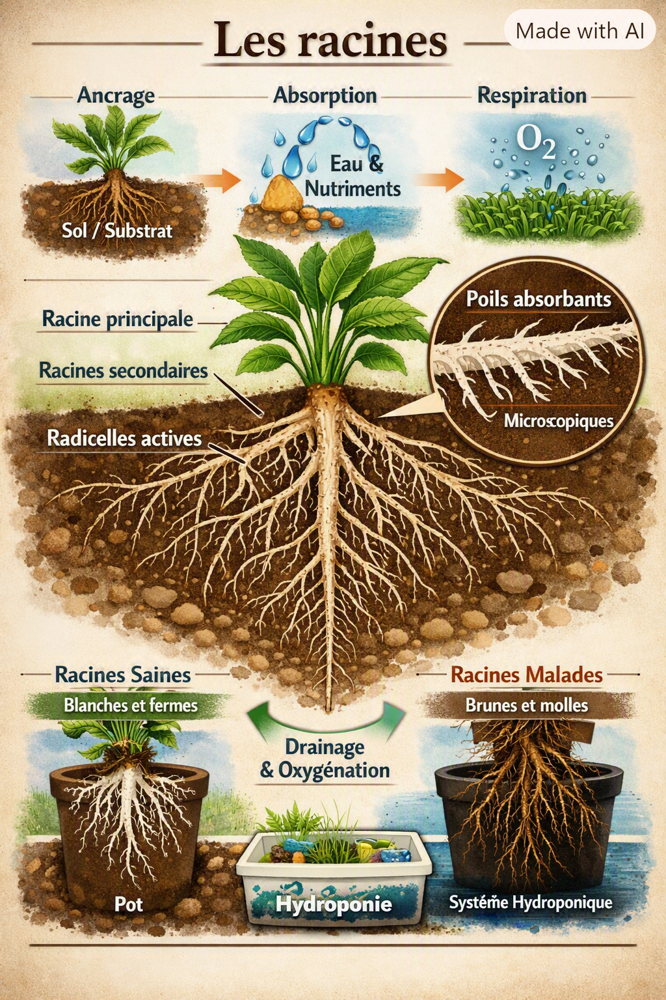

# Les racines

Les racines du cannabis sont un **système biologique beaucoup plus complexe** que ce que laisse entendre une simple description fonctionnelle. Elles ne se contentent pas d’absorber l’eau : elles **pilotent la croissance**, **dictent la vigueur**, et **fixent un plafond physiologique** à tout ce que la plante peut produire au-dessus du sol. Voici une version approfondie, structurée et scientifique, basée sur les sources récentes .

**Les racines**

Les racines ont trois rôles essentiels :

1. **Ancrer** la plante dans le milieu de culture.
2. **Absorber** l’eau et les éléments nutritifs.
3. **Respirer** (elles ont besoin d’oxygène).

<figure><figcaption></figcaption></figure>

Les racines les plus actives sont les **radicelles** (petites racines blanches et fines). Elles sont couvertes de poils absorbants microscopiques qui multiplient la surface d’échange avec le milieu. Une racine saine est blanche ou crème. Des racines brunes, molles ou qui sentent mauvais indiquent un problème (trop d’eau, manque d’oxygène, pathogènes).

En culture intérieure, le système racinaire est souvent limité par le volume du pot ou du système hydroponique. C’est pourquoi un bon drainage, une oxygénation correcte et un milieu aéré sont indispensables.

### 🌱 **1. Anatomie détaillée du système racinaire**

#### **Racine pivotante vs système fasciculé**

* **Plante issue de graine** : développe une **racine pivotante** profonde, avec des racines latérales qui colonisent le sol en largeur.
* **Plante issue de bouture** : ne forme **pas de pivot** ; elle produit des **racines adventives** en faisceau, plus superficielles.

Cette différence structurelle influence :

* la profondeur d’exploration du sol,
* la résistance au stress hydrique,
* la capacité d’ancrage,
* la vitesse d’absorption.

#### **Radicelles et poils absorbants : le cœur du système**

Les radicelles sont les **racines actives**, fines, blanches, couvertes de poils absorbants microscopiques. Ce sont elles qui :

* absorbent **99 %** de l’eau et des minéraux,
* réagissent le plus vite aux variations de pH, d’EC ou d’oxygène,
* meurent en premier en cas de stress (excès d’eau, pathogènes, chaleur).

Une racine saine est **blanche/crème**. Des racines **brunes, molles, odorantes** indiquent un manque d’oxygène ou une infection (pourriture racinaire).

### 🌬️ **2. L’oxygène : la variable maîtresse**

Les recherches récentes montrent que **la plupart des “carences” visibles sur les feuilles proviennent en réalité d’un manque d’oxygène dans la zone racinaire** .

Pourquoi ?

* Les racines respirent.
* Sans oxygène, elles cessent d’absorber les nutriments.
* La plante simule alors une carence (N, Ca, Mg, etc.) alors que la solution nutritive est correcte.
* Le manque d’oxygène ouvre la porte aux pathogènes (Pythium, Fusarium).

👉 **Le drainage, l’aération du substrat et la gestion de l’humidité sont plus importants que la quantité d’engrais.**

### 🧪 **3. La rhizosphère : un écosystème vivant**

Autour des racines se trouve la **rhizosphère**, une zone riche en :

* bactéries bénéfiques,
* champignons (mycorhizes),
* exsudats racinaires (sucres, acides organiques),
* microfaune du sol.

Les racines :

* **nourrissent** les microbes via leurs exsudats,
* **reçoivent** en échange des nutriments transformés (P, Fe, Zn),
* **communiquent** avec la plante via des hormones (auxines, cytokinines).

Un système racinaire sain est donc **un système microbien sain**.

### 🌡️ **4. Température de la zone racinaire**

La zone racinaire a sa propre physiologie :

* Trop froid (< 18°C) → absorption ralentie, croissance freinée.
* Trop chaud (> 26–28°C) → stress, manque d’oxygène, risque de pathogènes.

La température idéale dépend du stade, mais se situe généralement entre **20 et 24°C** pour une plante tropicale photopériodique.

### 🧱 **5. Le contenant façonne les racines**

Les études sur le chanvre industriel montrent une **variation de 175 % de la longueur totale des racines selon le génotype et l’environnement** .

En intérieur, le volume du pot limite :

* la profondeur,
* la ramification,
* la capacité d’absorption,
* la vigueur générale.

Les pots trop petits créent :

* un système racinaire “en spirale”,
* une saturation rapide,
* un stress hydrique chronique.

Les pots aérés (tissu, air‑pot) favorisent :

* la **pruning aérien** (auto‑taille des racines),
* la multiplication des radicelles,
* une meilleure oxygénation.

### 🔍 **6. Lire les racines : saines vs défaillantes**

#### **Racines saines**

* blanches ou crème
* fermes
* odeur neutre
* nombreuses radicelles fines
* croissance rapide du feuillage

#### **Racines en difficulté**

* brunes, translucides, molles
* odeur de fermentation
* peu de radicelles
* stagnation de la croissance
* feuilles qui jaunissent malgré une nutrition correcte

### 🧠 **7. Les racines comme système de signalisation**

Les racines produisent des hormones qui influencent :

* la croissance de la tige,
* l’étirement,
* la floraison,
* la résistance au stress.

Elles envoient aussi des signaux en cas de :

* manque d’eau,
* excès de sels,
* pathogènes,
* variations de température.

La plante réagit alors en modifiant :

* la taille des feuilles,
* la vitesse de croissance,
* la densité des stomates,
* la production de métabolites secondaires.

### 📌 **Synthèse : pourquoi les racines sont le “plafond” de la plante**

Tout ce que la plante peut produire — feuilles, tiges, fleurs — dépend de :

* l’oxygénation,
* la structure du substrat,
* la température,
* la santé microbienne,
* la densité des radicelles.

👉 **Les racines ne sont pas un organe passif : elles sont le moteur invisible de la plante.**
